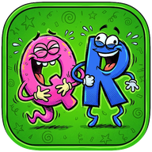
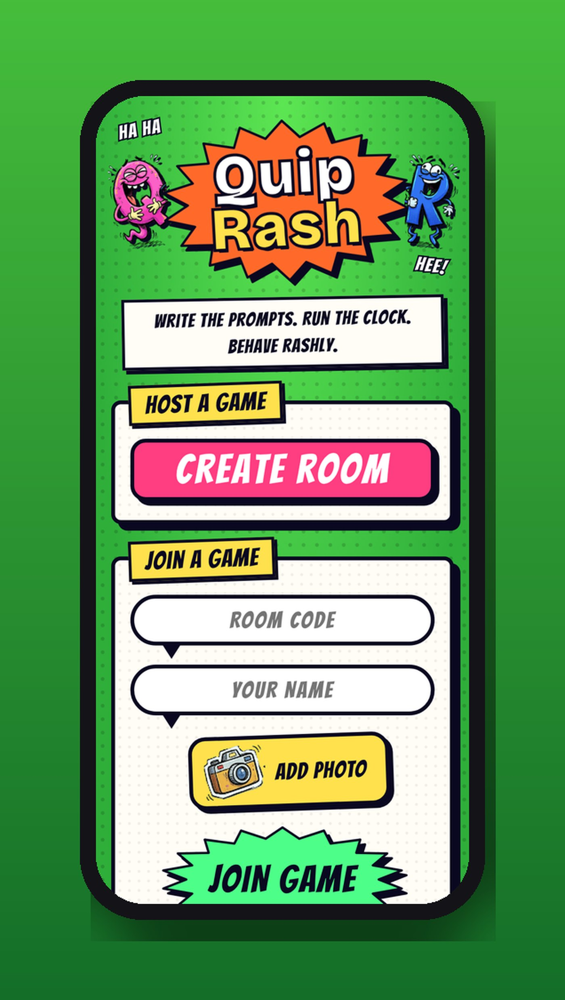
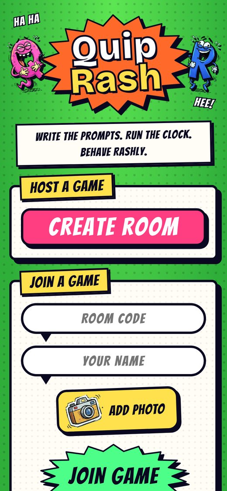

<h1 align="center">QuipRash</h1>

<em>Write the prompts. Run the clock. Behave rashly.</em>

<a href="https://joshp523.github.io/Quip-game-app/"><b>▶ Open the app</b></a>

QuipRash is a comic-book party game for any group with phones. The host puts the game on a laptop or TV; everyone else joins on their own phone with a four-letter code. Answer silly prompts, vote for the funniest answer, and see who takes the podium.

## How a game goes

1. **Create a room** on the big screen. Friends type the code on their phones and snap a photo (or get a random face).
2. **Answer** the prompts on your phone, privately.
3. **Vote** on head-to-head matchups. Rounds 2 and 3 are worth double and triple.
4. **Podium**, then play again. Ties go to sudden death.

Just two of you? It switches to head-to-head mode automatically.

<table><tr><td align="center" valign="top"> Start or join a game</td></tr></table>
## Why it's worth a look

- **Cool:** It feels like a TV game show, with comic art, timers, music and a podium at the end.
- **Innovative:** You write the prompts. The family's inside jokes become the game, and the prompt library grows every time you play.
- **Impressive:** It runs live across everyone's phones at once, with no app store, no accounts and no cost.
- **Useful:** Instant fun for a holiday table, a long video call, or a party of any size from 2 people up.

---

### On your phone
Open the link in Safari (iPhone/iPad) or Chrome (Android), then choose **Share → Add to Home Screen**. It gets its own icon and opens full-screen, just like an app from the store.

### More apps by Josh Riley
[The Riley Rag](https://joshp523.github.io/RileyRag/) · [Word Games](https://joshp523.github.io/Word-Games/) · [Russian Verbs](https://joshp523.github.io/russian/) · [Riley Rangers](https://joshp523.github.io/Rangers-app/) · [Habits: Josh](https://joshp523.github.io/daily-discipline/) · [Habits: Meishe](https://joshp523.github.io/Habit-tracker-app-Meishe/) · [Habits: Grandma](https://joshp523.github.io/wendys-app/) · [Writing](https://joshp523.github.io/writing-app/)

Built by Josh Riley. Setup notes for whoever maintains it are in [SETUP.md](SETUP.md).
